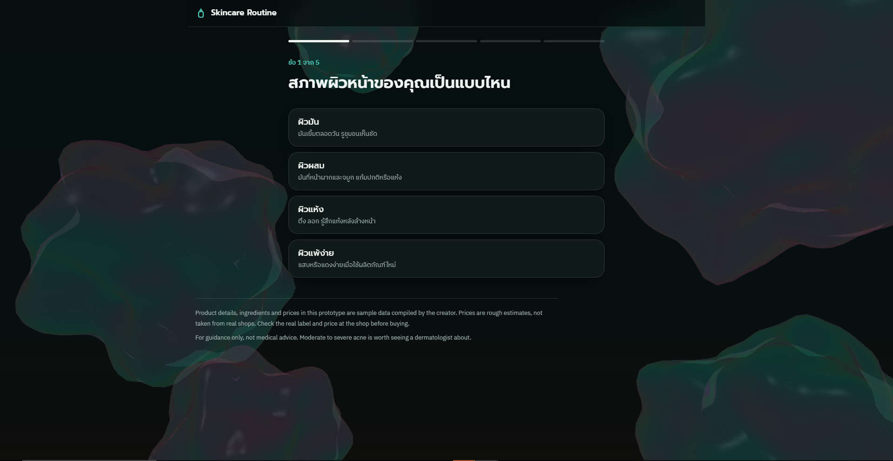
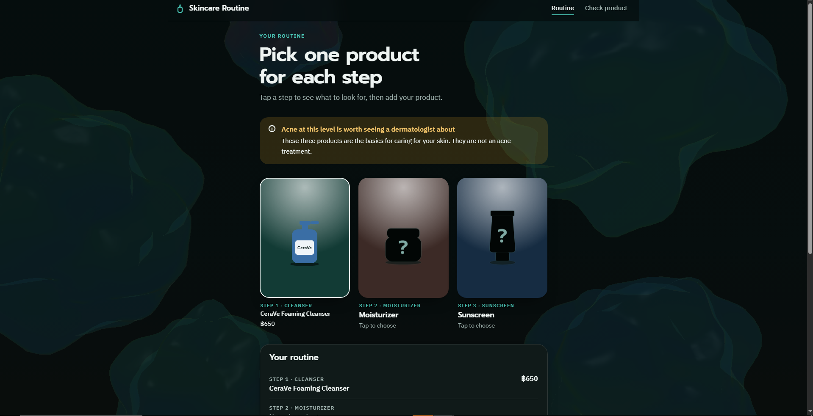
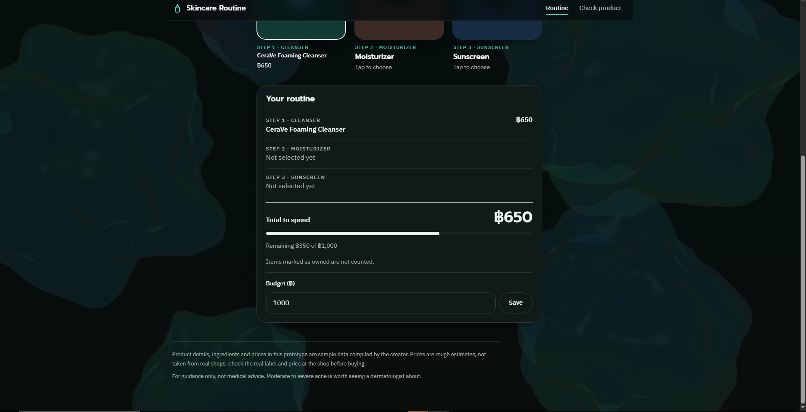

# 🧴 Skincare Planner

A skincare planning web app that builds a **basic routine around your skin type and budget**. Answer five questions, check whether a product suits your skin, and see the total cost before you buy.

### ▶️ [Try the app](https://juicypapaya.github.io/Skincare-Planner/)

---

## Overview

Runs in any web browser on mobile or desktop. No installation or sign-up required. Your data stays in your browser. The onboarding quiz is in Thai and the rest of the interface is in English.

> **Status:** prototype. The database covers 63 products with ingredient lists and prices taken from Thai shop pages (seen in Nov 2026). Prices change often, and a few products have no price yet.

## What It Helps You Do

After using the app, you can:
- Identify what to look for in a cleanser, moisturizer and sunscreen for your skin type
- Check whether a specific product is a good, careful or poor match for your skin
- Compare the total cost of your routine with your budget

## How to Use

1. Open the app and answer the five questions (skin type, acne severity, main acne concern, experience, budget).
2. On the home page, press **Start your routine** to open your routine.
3. See guidance for cleanser, moisturizer and sunscreen, plus a money-saving tip for each.
4. Go to **Check a product** and type a name in English or Thai (e.g. "CeraVe" or "เซราวี").
5. Read the result: fit level, reason, key ingredients, full ingredient list, price with a link to the source page, and cheaper alternatives.
6. Add the product to your routine and mark it *to buy* or *bought*. If a product has no listed price, enter it yourself. The budget bar shows your total and warns you when you go over.
7. Can't find a product? Use **Can't find your product?** and paste the ingredient list from the label (see the note on Claude checks below).

## Features

| Feature | Details |
| --- | --- |
| Onboarding quiz | 5 questions in Thai: skin type, acne severity, acne concern, experience, budget |
| Product checker | Rates each product *Great match*, *Use with care* or *Not ideal* for your profile, with the reason |
| Ingredient lists | Key ingredients explained in plain words, plus the full ingredient list for each product |
| Prices with sources | Price from Thai shop pages, with a link to the source page |
| Cheaper alternatives | Suggests lower-priced options and reminds you to compare bottle size |
| Products not in the database | Paste a label's ingredients for a check. Results are labelled as estimates (Claude only, see below) |
| Thai and English search | Finds products by brand or product name in either language |
| Routine builder | Three slots (cleanser, moisturizer, sunscreen) with guidance by skin type |
| Budget summary | Total cost vs budget with a progress bar that flags overspending |
| Dermatologist notice | Banner appears when acne is severe or nodular |
| Saved progress | Profile and routine are saved automatically in your browser |

## Skin Types Covered (4)

Oily · Combination · Dry · Sensitive

## Products in the Database (63)

| Category | Count |
| --- | --- |
| Cleanser | 30 |
| Moisturizer | 20 |
| Sunscreen | 13 |

30 brands, including CeraVe, Cetaphil, La Roche-Posay, Neutrogena, Simple, Eucerin, Bioderma, Hada Labo, Biore, Anessa, COSRX, Anua, Skin1004, Beauty of Joseon and several Thai drugstore brands. Ingredient lists and prices come from the product pages linked in the app.

## Screenshots

| Home | Onboarding |
| --- | --- |
|  |  |

| Routine | Routine (budget summary) |
| --- | --- |
|  |  |

| Product check | Product check (result) |
| --- | --- |
|  |  |

## Built With

- HTML, CSS, JavaScript (single file)
- three.js r128 (from cdnjs) for the 3D liquid background, with a gradient fallback when WebGL is unavailable
- localStorage for saving the profile and routine
- Claude artifact runtime (optional) for the "Check with Claude" feature
- Google Fonts: Prompt, IBM Plex Sans Thai

## Note on "Check with Claude"

The **Can't find your product?** form can ask Claude to check a product from pasted ingredients or just a name. This uses the Claude artifact runtime, so it only works when the page is opened through Claude. On GitHub Pages and when run locally, the app shows a message that Claude checks are not available. Everything else works normally.

## Run Locally

Download `index.html` and open it in any browser. An internet connection is needed for fonts and three.js.

## Disclaimer

For general guidance only, not medical advice. Ingredient lists come from the product pages linked in the app and can differ from the bottle you buy, because formulas vary by country. Prices were seen on Thai shop pages in Nov 2026 and change often. Results from Claude are estimates. Always check the real label and price before buying. Moderate to severe acne is worth seeing a dermatologist about.

## Author

Q · [GitHub](https://github.com/JuicyPapaya)
