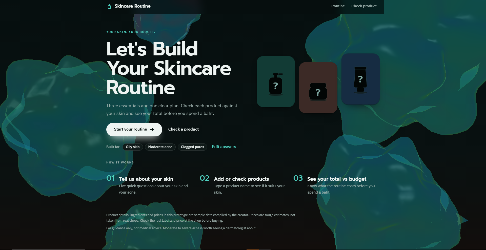
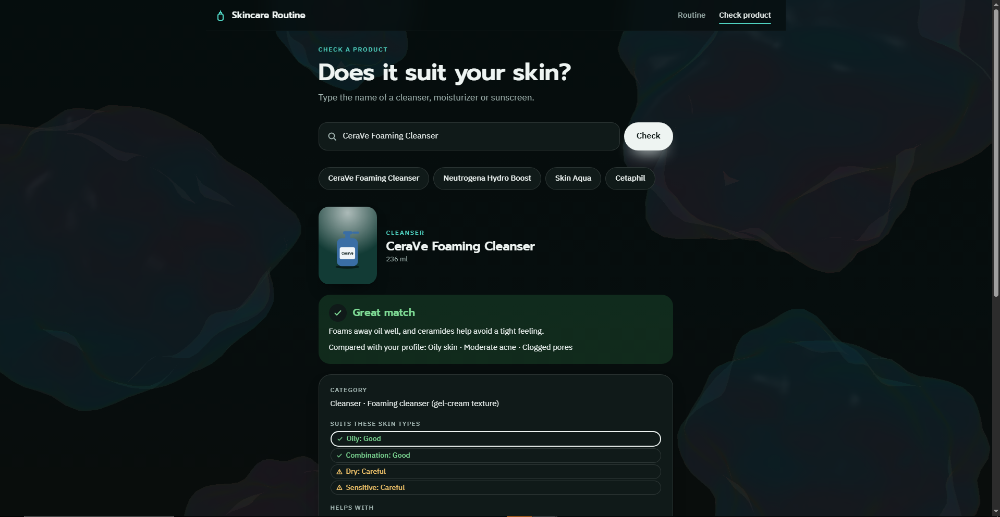
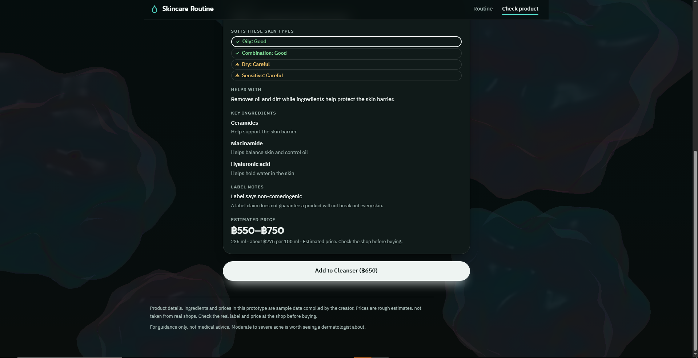

# 🧴 Skincare Planner

A skincare planning web app that builds a **basic routine around your skin type and budget**. Answer five questions, check whether a product suits your skin, and see the total cost before you buy.

### ▶️ [Try the app](https://juicypapaya.github.io/Skincare-Planner/)

---

## Overview

Runs in any web browser on mobile or desktop. No installation or sign-up required. Your data stays in your browser. The onboarding quiz is in Thai and the rest of the interface is in English.

> **Status:** prototype. The product database is small and prices are estimates.

## What It Helps You Do

After using the app, you can:
- Identify what to look for in a cleanser, moisturizer and sunscreen for your skin type
- Check whether a specific product is a good, careful or poor match for your skin
- Compare the total cost of your routine with your budget

## How to Use

1. Open the app and answer the five questions (skin type, acne severity, main acne concern, experience, budget).
2. On the home page, press **Start your routine** to open your routine.
3. See guidance for cleanser, moisturizer and sunscreen, plus a money-saving tip for each.
4. Go to **Check a product** and type a name in English or Thai (e.g. "CeraVe" or "เซราวี").
5. Read the result: fit level, reason, key ingredients, estimated price and alternatives.
6. Add the product to your routine and mark it *to buy* or *bought*. The budget bar shows your total and warns you when you go over.

## Features

| Feature | Details |
| --- | --- |
| Onboarding quiz | 5 questions in Thai: skin type, acne severity, acne concern, experience, budget |
| Product checker | Rates each product *Great match*, *Use with care* or *Not ideal* for your profile |
| Thai and English search | Finds products by brand or product name in either language |
| Routine builder | Three slots (cleanser, moisturizer, sunscreen) with guidance by skin type |
| Budget summary | Total cost vs budget with a progress bar that flags overspending |
| Dermatologist notice | Banner appears when acne is severe or nodular |
| Saved progress | Profile and routine are saved automatically in your browser |

## Skin Types Covered (4)

Oily · Combination · Dry · Sensitive

## Products in the Database (13)

| Category | Products |
| --- | --- |
| Cleanser | CeraVe Foaming Cleanser, CeraVe Hydrating Cleanser, Cetaphil Gentle Skin Cleanser, La Roche-Posay Effaclar Purifying Foaming Gel, Simple Kind to Skin Refreshing Facial Wash |
| Moisturizer | CeraVe Moisturising Lotion, Neutrogena Hydro Boost Water Gel, Cetaphil Moisturising Cream, Simple Hydrating Light Moisturiser |
| Sunscreen | Skin Aqua UV Super Moisture Gel, Biore UV Aqua Rich Watery Essence, Neutrogena Ultra Sheer Dry-Touch Sunscreen, Beauty of Joseon Relief Sun: Rice + Probiotics |

## Screenshots

| Home | Onboarding |
| --- | --- |
|  |  |

| Routine | Routine (budget summary) |
| --- | --- |
|  |  |

| Product check | Product check (result) |
| --- | --- |
|  |  |

## Built With

- HTML, CSS, JavaScript (single file)
- three.js r128 (from cdnjs) for the 3D liquid background, with a gradient fallback when WebGL is unavailable
- localStorage for saving the profile and routine
- Google Fonts: Prompt, IBM Plex Sans Thai

## Run Locally

Download `index.html` and open it in any browser. An internet connection is needed for fonts and three.js.

## Disclaimer

For general guidance only, not medical advice. Formulas and prices vary by country and change over time, so check the label and price in store before buying. Moderate to severe acne is worth seeing a dermatologist about.

## Author

Q · [GitHub](https://github.com/JuicyPapaya)
